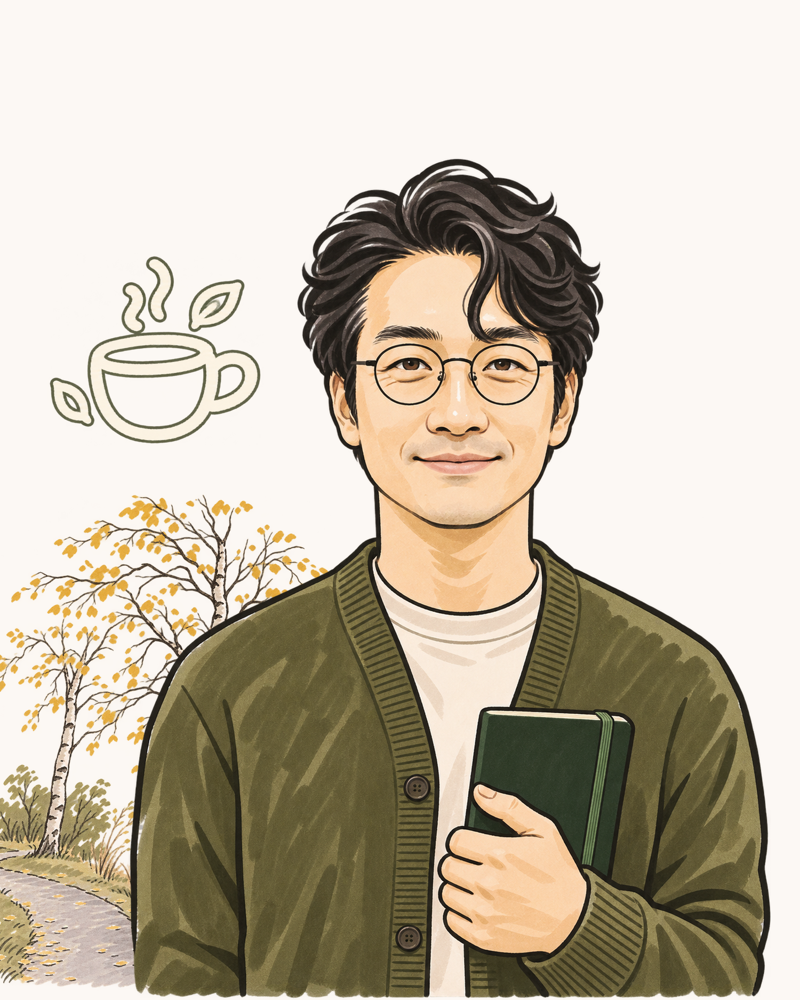
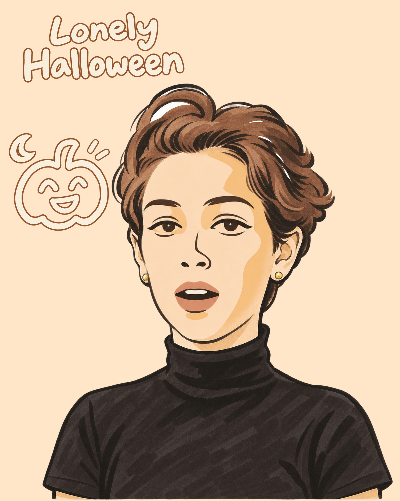
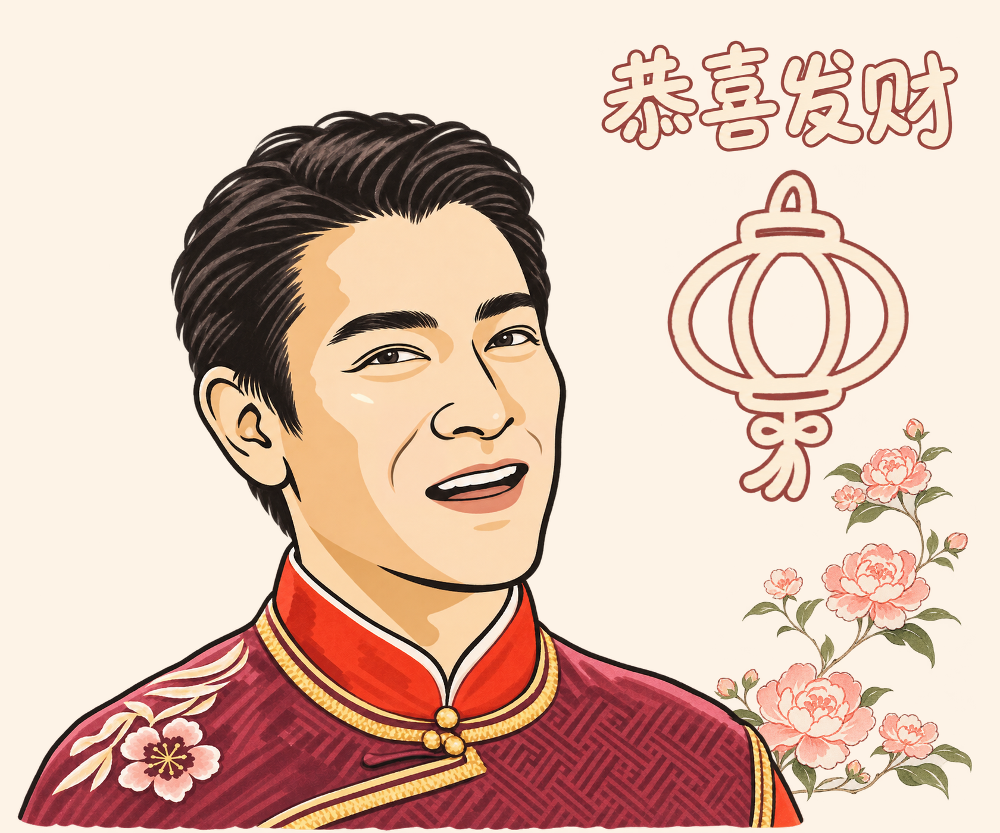

# 个人手绘肖像

`$handdrawn-portrait-kit` 把人物照片绘成手绘风胸像，可用于个人头像、赠礼或纪念海报。画法使用粗黑外线、轻笔内线和马克笔平涂。可以只画人物，也可以加入照片里的风景、自带实景、预设地标或手绘文字和图标。

## 使用

[下载 ZIP 安装包](https://github.com/Reimagica/handdrawn-portrait-kit/releases/latest/download/handdrawn-portrait-kit.zip)，解压后将完整 Skill 文件夹放到 `~/.codex/skills/handdrawn-portrait-kit/`。重新打开 Codex 会话，上传人物照并输入 `$handdrawn-portrait-kit`。生图需要会话具备图像生成能力。

1. 提供人物照和想保留的特征，例如眼镜、表情、衣着或手势。
2. 指定照片中的背景、另传实景、选预设，或跳过风景。
3. 给出 1–3 组装饰文字或图标描述，也可跳过装饰。文字和图标用醒目的马克笔贴图，描边随画面取色。输入齐备时可以一次说明。
4. 查看独立透明 PNG 和拼接稿。改景、改字或调整位置时可直接复用人物层。

## 成品示例

| [张三](examples/zhang-san.png) | [Lonely Halloween](examples/lonely-halloween.png) | [刘德华 · 恭喜发财](examples/andy-lau-gong-xi-fa-cai.png) |
| --- | --- | --- |
|  |  |  |
| 湖畔白桦与咖啡杯贴图 | 暖橙纸底、棕橙描边标题与南瓜贴图 | 牡丹场景、朱红描边标题与灯笼贴图 |

张三是虚构的 AI 研究者。这张个人画像使用[生成的参考照](examples/zhang-san-source.jpg)。

> 用 $handdrawn-portrait-kit 画张三的个人手绘画像。保留正面头部姿态、圆眼镜、橄榄绿开衫和手持笔记本的动作。风景用参考照里的白桦和湖边步道。装饰用大号奶白马克笔咖啡杯贴图和深橄榄细描边，采用竖幅。

可查看[贴图参考](assets/decoration-style.png)、[面部勾线参考](assets/face-linework-example.png)、[色卡](assets/portrait-palette.png)、[笔法参考](assets/portrait-technique.png)和[五款框线](assets/layout-templates/overview.png)。完整流程见 [SKILL.md](SKILL.md)。本地拼接已有图层需要 Python 和 Pillow，命令和布局格式见[拼接说明](references/decoration-and-layout.md#本地拼接)。
